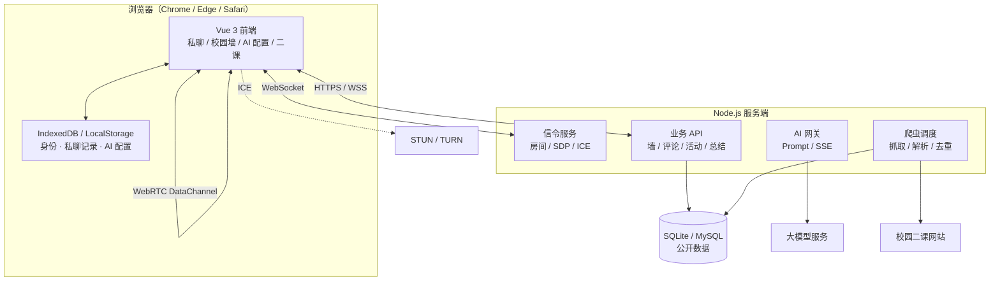

# 系统架构设计

## 1. 总体架构

系统采用五层架构：前端层、信令服务层、P2P 通信层、AI 智能层、数据存储层。



## 2. 模块划分

| 模块 | 职责 | 代码位置 | 负责人 |
|---|---|---|---|
| 匿名身份 | 匿名 ID、令牌、本地配置 | `apps/server/src/auth/` | 汪星同 |
| 信令服务 | 房间、SDP/ICE 转发 | `apps/server/src/signaling/` | 汪星同 |
| P2P 私聊 | DataChannel、消息、重连 | `apps/web/src/features/chat/` | 张米奇 |
| 校园墙 | 发帖、信息流、互动、举报 | `apps/web/src/views/wall/`、`apps/server/src/wall/` | 黄仁才 |
| AI 能力 | 网关、SSE、人设、技能 | `apps/server/src/ai/`、`apps/web/src/features/ai/` | 张米奇 |
| 二课工具 | 抓取、活动、总结、导出 | `apps/server/src/activities/` | 陈永学 |
| 测试与 CI | 单测、接口测试、覆盖率 | `tests/`、`.github/workflows/` | 陈永学 |

## 3. 关键数据流

### 3.1 发帖

```text
用户输入 → 前端校验（长度/分类/敏感词）
        → POST /api/v1/wall/posts
        → 服务端鉴权 → 二次过滤 → 写入 DB → 返回 postId
        → 前端插入信息流顶部
```

### 3.2 P2P 私聊

```text
A 创建房间 → 信令服务返回 roomId/passcode
B 加入房间 → 信令服务转发 Offer/Answer/ICE
双方 DTLS 握手 → DataChannel 建立
消息 → 浏览器加密直传（服务端不可见）
```

### 3.3 二课总结

```text
选择活动 + 填写要点 → POST /summaries
→ 服务端组装 Prompt（人设 + 活动 + 要点）
→ 调用 LLM（流式）→ SSE 推送前端
→ 用户编辑 → 导出 Markdown/TXT
```

## 4. 数据存储划分

| 数据 | 存储位置 | 说明 |
|---|---|---|
| 匿名身份 | IndexedDB + 服务端 User 表 | 仅匿名 ID、昵称、创建时间 |
| 私聊消息 | IndexedDB | **不写入服务端** |
| AI 人设/技能 | IndexedDB | 可导出 JSON，不上传 |
| 校园墙 | 服务端 DB | 公开数据，软删除 |
| 二课活动 | 服务端 DB | 公开数据，按来源去重 |
| 总结 | 服务端 DB 或本地 | 默认仅本人可见 |

## 5. 关键设计决策

| 编号 | 决策 | 理由 | 备选 |
|---|---|---|---|
| ADR-001 | 采用 WebRTC DataChannel + 自建信令 | 浏览器原生加密、低延迟、服务端不接触消息 | Socket.IO 中继、Matrix |
| ADR-002 | 公私数据分离存储 | 降低隐私风险，符合“私聊不落库” | 全部服务端存储 |
| ADR-003 | AI 调用统一走服务端网关 | 保护密钥、限流、可替换模型 | 前端直连 LLM |
| ADR-004 | 开发期 SQLite、部署期 MySQL | 降低本地启动成本，保留扩展性 | 直接上 MySQL |

## 6. 部署

```bash
pnpm build
pnpm start          # 或 docker compose up -d
```

生产环境需配置 HTTPS/WSS、TURN 服务、数据库备份与日志轮转。
